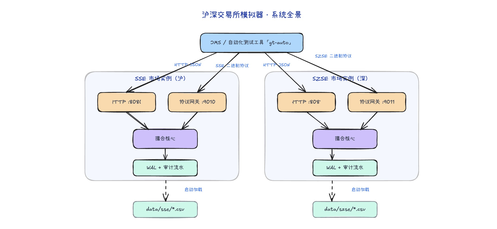

# exchange-simulator-rs

交易所模拟器（Simulator / Matcher）：在本地或测试环境复现真实交易所的核心行为——账户资金管理、订单接收、风控校验、订单簿撮合、成交结算，供上游系统（OMS、交易网关、自动化测试工具）做集成测试与验收测试。

进程内同时运行 **上交所（SSE）** 与 **深交所（SZSE）** 两套独立市场实例，各自持有独立的撮合核心、账户/标的基础数据、HTTP 端口与二进制协议网关。


## 特性

- **行为仿真**：资金冻结、手续费、部分成交、多种订单类型（GTC/IOC/FOK/FOK_BUDGET/IOC_BUDGET/POST_ONLY/DAY/GTD）；撤单可经 HTTP `POST /cancel` 或二进制协议网关下达
- **高性能**：撮合核心基于 Disruptor 环形缓冲区 + 单线程流水线（`LocalSet` + `current_thread` 运行时），全整数运算、零锁竞争
- **故障恢复**：运行期 WAL 持久化，进程崩溃后全量重放恢复余额冻结与订单簿
- **协议网关**：SSE / SZSE 二进制协议接入（含会话状态机、回执回报），HTTP 接口用于轻量联调
- **可测试**：脚本化用例驱动（`testcase/` + `gt-auto`），配套双市场回归与恢复演练脚本

**非目标**：不做行情发布、不做真实清算交收、不做多节点分布式部署、不面向生产交易。

## 技术栈

| 项 | 说明 |
|----|------|
| 语言 | Rust（edition 2024，CI 固定 toolchain 1.92） |
| 异步 | tokio（`current_thread` + `LocalSet`） |
| HTTP | axum 0.8 |
| 撮合核心 | [matching-core](https://github.com/xinchentechnote/matching-core)（外部 crate） |
| 协议编解码 | sse-binary / szse-binary / binary-codec（外部 crate） |
| 配置 / 校验 | toml、serde、validator |
| 日志 | tracing + tracing-subscriber（`RUST_LOG` 可覆盖级别） |

## 快速开始

```bash
cargo run -- --config conf/config.toml   # --config 缺省即 conf/config.toml
```

启动后监听（默认配置，见 `conf/config.toml`）：

| 市场 | HTTP 下单接口 | 二进制协议网关 |
|------|--------------|----------------|
| SSE  | `127.0.0.1:8080` | `127.0.0.1:9010` |
| SZSE | `127.0.0.1:8081` | `127.0.0.1:9011` |

单笔下单示例：

```bash
curl -X POST http://127.0.0.1:8080/place -H 'Content-Type: application/json' \
  -d '{"order_id":1,"user_id":10001,"action":"1","order_type":"GTC","price":1000,"size":100,"symbol":600000}'
```

- `action`：`1`=买入、`2`=卖出，其余值返回 400
- `reserve_price`（可选）：买单资金冻结预留价，缺省或 0 时按 `price` 冻结；买单该值低于委托价会被拒绝
- `symbol` / `user_id` 需存在于 `data/{market}/` 的基础数据中

撤单示例（标的无需另传，由订单注册表回查；同步返回撤单终态与解冻后的订单快照）：

```bash
curl -X POST http://127.0.0.1:8080/cancel -H 'Content-Type: application/json' \
  -d '{"order_id":1,"user_id":10001}'
# {"order_id":1,"result_code":"Success","accepted":true,"status":"filled","leaves_qty":0}
```

## HTTP 接口

| 方法 | 路径 | 说明 |
|------|------|------|
| `POST` | `/place` | 下单，返回执行报告 |
| `POST` | `/cancel` | 撤单，返回撤单终态 + 订单快照；目标订单不存在返回 404 |
| `GET` | `/orders/{order_id}` | 查询订单记录，不存在返回 404 `order_not_found` |
| `GET` | `/accounts/{uid}/balances` | 查询账户余额，响应为 `{币种: 金额}` 映射 |
| `GET` | `/trades?symbol=&limit=` | 最近成交流水（内存环形缓冲，按时间正序；`limit` 默认 100、上限 1000） |
| `GET` | `/admin/state` | 运行汇总，用于对账（订单/成交总数、注册表规模、余额合计） |
| `GET` | `/health` | 就绪探针，返回 `{"status":"ok","exchange":"sse"}`；核心停机中返回 503 |

失败响应形状统一为 `{"error": <码>, "detail": <可选>}`，包括请求体不是合法 JSON（400）、缺 `Content-Type: application/json`（415）、路径/查询参数类型不符（400）等提取器失败场景。

完整请求/响应字段与错误码定义见 [docs/DEVELOPMENT_DESIGN.md](./docs/DEVELOPMENT_DESIGN.md) §5.1。

## 目录结构

```
src/
  main.rs              进程入口：按市场引导核心 + HTTP + 网关
  config.rs            TOML 配置与命令行参数解析
  core_bridge.rs       HTTP/网关与 matching-core 之间的桥接层
  handle.rs            axum 路由与请求映射
  model.rs             请求模型与校验
  base_info_service.rs 标的/账户基础数据装载
  logging.rs errors.rs
  sse_gateway/         SSE 二进制协议网关（codec/session/adapter/report）
  szse_gateway/        SZSE 二进制协议网关（同上结构）
conf/config.toml       双市场运行配置
data/{sse,szse}/       symbol_data.csv、account_data.csv 基础数据
                       以及运行期 wal.log、orders.jsonl
testcase/{sse,szse}/   gt-auto 用例（csv）与网关配置
tests/                 集成测试（双市场 + 各网关）
scripts/               sim.sh（服务起停/重启/故障恢复/状态查看）、recovery_drill.sh（WAL 恢复演练）
docs/                  架构与详细设计文档
```

## 配置

主配置为 `conf/config.toml`，每个市场实例一段（`[sse]` / `[szse]`），关键字段：

- `enabled`：是否启用该市场
- `server_port` / `gateway_port` / `gateway_protocol`（`sse` | `szse`）
- `[*.matcher]`：`symbol_info_path`、`account_info_path`
- `[*.matcher.core]`：`ring_buffer_size`、`matching_engines_num`、`risk_engines_num`、`producer_type`、`wait_strategy`（缺省值同 matching-core）
- `[*.matcher.persistence]`：`wal_path`（缺省关闭故障恢复）、`orders_log_path`（订单/成交审计流水，缺省关闭）

日志级别由 `[logging] level` 指定，可被环境变量 `RUST_LOG` 覆盖。

## 测试

```bash
cargo test                      # 单元测试 + tests/ 集成测试
./scripts/sim.sh start          # 启动服务（--clean 清理 WAL 后全新启动）
./scripts/sim.sh status         # 查看运行状态与监听端口
./autotest.sh                   # SSE + SZSE 双市场场景回归（需已安装 gt-auto；sim.sh stop 后 start --clean 可保证全新状态）
bash scripts/recovery_drill.sh before && \
  bash scripts/recovery_drill.sh after   # WAL 崩溃恢复演练（before 后手工 kill -9 并重启）
./scripts/sim.sh drill          # 崩溃演练：kill -9 → 重启 → WAL 重放 → 前后对账
./scripts/sim.sh recover        # 故障恢复拉起（不杀进程；WAL 存在即自动重放，输出恢复证据）
```

CI（`.github/workflows/ci.yml`）执行 `cargo fmt --check`、`cargo clippy --all-targets -- -D warnings`、`cargo test`、`cargo build --release`，`CARGO_NET_GIT_FETCH_WITH_CLI=true` 用于拉取 git 依赖。

## 文档

- [docs/ARCHITECTURE.md](./docs/ARCHITECTURE.md) — 系统上下文、运行时与线程模型、关键流程、演进路线
- [docs/DEVELOPMENT_DESIGN.md](./docs/DEVELOPMENT_DESIGN.md) — 模块级详细设计：数据字典、接口规格、错误码、测试设计与任务拆解
