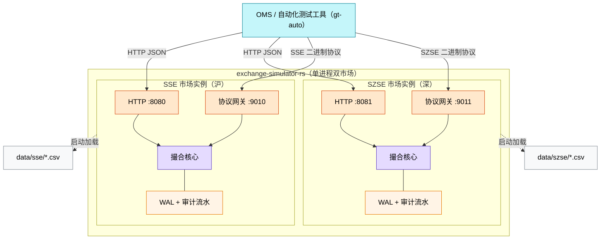
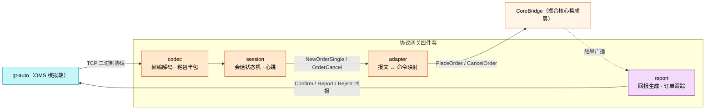
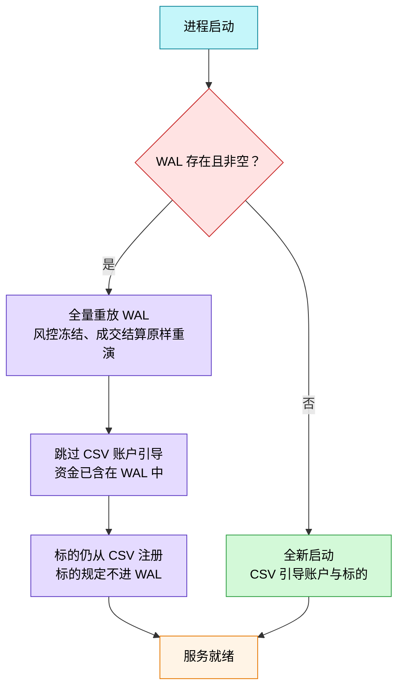
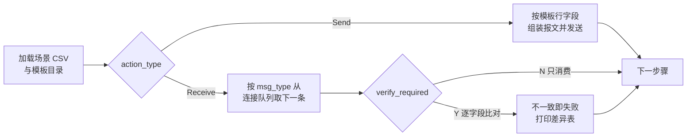

# 用 Rust 造一台"交易所"：沪深双市模拟撮合引擎的设计与实现

> 一台笔记本上跑起"上交所 + 深交所"：订单簿撮合、资金冻结、二进制协议网关、kill -9 后原地满血复活。这篇文章记录整个模拟器的设计与实现。

## 引子：联调之痛

如果你做过交易系统的开发，一定熟悉这种场景：OMS（订单管理系统）写完了，想验证一笔订单从报出、受理、成交到结算的全链路，唯一的办法是接入真实交易所的测试环境——申请证书、配置席位、等待测试时段，还经常碰上"系统检修"。于是很多团队退而求其次，把撮合环节 mock 掉。

但 mock 掉撮合，就测不到那些最要命的边界：

- 买单下单时资金怎么冻结？部分成交后冻结额怎么释放？
- 撤单被拒（订单已经成交了）时，OMS 该收到什么回报？
- 网关会话半路断线重连，序列号对不上怎么办？

这些恰恰是交易系统事故的高发区。所以我们需要的是一个**行为级仿真的交易所**，而不是一个只会回 `{"ok": true}` 的假服务。

这就是 [exchange-simulator-rs](https://github.com/xinchentechnote/exchange-simulator-rs) 的由来：用 Rust 实现一个在本地复现真实交易所核心行为的模拟器——账户资金管理、订单接收、风控校验、订单簿撮合、成交结算，一个不少。先交代一个重要的定位：其中的撮合核心 matching-core **fork 自开源项目而非自研**（下文详述），本工程做的是给这颗"心脏"搭建完整的躯体——接入层、结果路由、沪深双协议网关与故障恢复。它已经在本人的沪深两套协议联调中真实落地：SSE（上交所）二进制协议 4 个场景 14 个校验步骤、SZSE（深交所）协议 4 个场景 10 个校验步骤，全部通过。

下面按设计决策的顺序，把整个引擎拆开来讲。

## 一、定位：仿真什么，不仿真什么

先划边界。模拟器的**目标**是复现真实交易所的语义：

| 目标 | 说明 |
|------|------|
| 行为仿真 | 资金冻结、手续费、部分成交、撤单解冻、GTC/IOC/FOK/POST_ONLY 等订单类型 |
| 高性能 | Disruptor 环形缓冲 + 单线程流水线，全整数运算、零锁竞争 |
| 故障恢复 | 运行期 WAL 持久化，进程崩溃后重放恢复余额冻结与订单簿 |
| 协议仿真 | SSE / SZSE 二进制协议接入（会话状态机 + 回执回报），HTTP 接口用于轻量联调 |

**非目标**同样明确：不做行情发布、不做真实清算交收、不做多节点分布式、不面向生产交易。边界清晰，才能把复杂度花在刀刃上。

一个进程内同时运行两个完全隔离的市场实例（SSE + SZSE），各自持有独立的撮合核心、基础数据、HTTP 端口和二进制协议网关——这也是真实交易所的形态：两个市场，两套规则。



## 二、心脏：命令即事件的三级流水线

先说清楚"心脏"的出处：流水线来自开源撮合核心 [matching-core](https://github.com/llc-993/matching-core)——一个基于 LMAX Disruptor 模式的 Rust 高性能撮合库，本工程 **fork 该开源项目**后按需维护，以 git tag v0.2.2 固定引入，并非自研。本文讲清它的流水线如何运转，也讲清模拟器自研的部分——如何围绕这颗心脏构建接入、路由、协议与恢复的完整躯体。

撮合引擎的核心设计只有一句话：**命令即事件**。

同一条 `OrderCommand` 结构贯穿"请求 → 处理 → 结果"，不带任何包装。每条命令进入 64K 的 Disruptor 环形缓冲区后，由专用消费线程按固定顺序流过三级流水线：


**R1（风控预处理）**：买单冻结 `size × reserve_price × quote_scale_k + size × taker_fee`，卖单冻结等值证券。余额不足直接打回 `RiskNsf`，订单根本不会见到订单簿。

**撮合引擎**：按标的路由到对应订单簿，做价格/时间优先撮合，产出的成交、拒绝、减量事件写进命令自带的 `matcher_events` 字段。

**R2（结算后处理）**：遍历成交事件做双边记账——卖方收款扣手续费，买方收证券并**退差价**。

这里有个值得展开的设计：**`reserve_price`（冻结预留价）**。买单冻结按预留价计算（可以高于委托价），成交后按实际成交价退回差额。这样即使行情剧烈波动、订单以劣于预期的价格成交，也绝不会把账户扣穿——这正是真实交易所"先冻结、后清算、多退少补"的语义。

另一个贯穿始终的原则是**全整数运算**。所有价格、金额、数量都是 `i64`，通过 `scale_k` 数量级乘数换算（如 A 股一手 100 股 → `base_scale_k = 100`），金额以最小货币单位（分）计。浮点数在金融记账里是原罪，`0.1 + 0.2 != 0.3` 的故事不需要在交易所里重演。

而 `result_code` 的流转规则非常优雅：命令以 `New` 初始化，风控通过则覆写为 `ValidForMatchingEngine`，最终撮合/结算完成后变为 `Success`；任何一环拒绝则保留该环节的拒绝码（`AuthInvalidUser`、`RiskNsf`、`MatchingUnknownOrderId`……）。**一条命令流过整条流水线，出来时自带终态**——不需要额外的状态查询协议。

## 三、运行时模型：当 `!Send` 遇上异步 Web

Rust 工程上最有意思的部分来了。

撮合核心 `ExchangeCore` 持有 Disruptor 生产者句柄和流水线，它**不是 `Send` 的**——无法扔进普通的 `tokio::spawn`。而 HTTP 层（axum）天然是多任务并发的 `Send` 世界。两边的并发模型怎么调和？

答案是 `current_thread` 运行时 + `LocalSet`：

```rust
fn main() {
    // 单线程 tokio 运行时
    let rt = tokio::runtime::Builder::new_current_thread()
        .enable_all().build().expect("构建 tokio 运行时失败");
    rt.block_on(async {
        LocalSet::new().run_until(run(cfg)).await;
    });
}

async fn run(cfg: Config) {
    // !Send 的撮合核心宿主任务：spawn_local 留在本地线程
    let (bridge, core_task, _) = core_bridge::bootstrap_exchange(name, conf).await?;
    // HTTP 服务与核心同处一个 LocalSet，协作式调度
    tokio::task::spawn_local(async move {
        axum::serve(listener, app).with_graceful_shutdown(...).await
    });
    // ...
}
```

axum 的 handler 在 `Send` 世界运行，要把命令送进本地任务里的核心，靠一条 `mpsc::channel(1024)` 完成跨越。这个通道同时是**天然的背压阀门**：通道满时 `tx.send().await` 挂起，上游自动限流，撮合核心永远不会被请求洪峰压垮。

而在另一个极端，Disruptor 消费线程以 **BusySpin** 自旋等待命令——不睡眠、不让出 CPU，用满一个核换取最低的唤醒延迟。整条链路上，"Web 世界的协作式调度"与"交易世界的自旋等待"各取所需，中间只隔一条有界队列。

这个设计的代价也说人话：单线程 `LocalSet` 意味着 HTTP 层和核心宿主任务共享一个核的调度预算。但对模拟器来说这恰恰是对的——它的性能瓶颈在撮合，而撮合被隔离在专用消费线程上；HTTP 只是入口，单线程足够。

## 四、给异步核心装上"同步开关"：结果路由

流水线是异步消费的（命令进环形缓冲，结果从消费线程回调），但 HTTP 下单方期望的是**同步语义**：我发出请求，你要告诉我这笔单子到底成了没有。中间隔着一个 Disruptor 消费线程，怎么把结果精准地送回等待者？

这是整个工程含金量最高的一段。`CoreBridge` 的方案分三步：

**第一步，登记等待。** 下单时在 `pending` 表插入 `order_id → oneshot::Sender`，同时做幂等检查——同一个 `order_id` 既在注册表又在 pending 表，说明重复提交，直接 409：

```rust
pub async fn execute(&self, cmd: OrderCommand)
    -> Result<ExecutionReport, SimError> {
    let order_id = cmd.order_id;
    let (report_tx, report_rx) = tokio::sync::oneshot::channel();
    {
        let mut shared = self.shared.lock().unwrap();
        if shared.registry.contains_key(&order_id)
            || shared.pending.contains_key(&order_id) {
            return Err(SimError::DuplicateOrderId);      // 幂等：拒绝重复订单号
        }
        shared.pending.insert(order_id, report_tx);      // 登记等待者
    }
    if self.command_tx.send(cmd).await.is_err() {
        return Err(SimError::CoreUnavailable);           // 核心已停机
    }
    match tokio::time::timeout(EXECUTE_TIMEOUT, report_rx).await {
        Ok(Ok(report)) => Ok(report),                    // 拿到终态
        Ok(Err(_)) => Err(SimError::CoreUnavailable),
        Err(_) => {
            // 超时必须清登记，否则该订单号永久被误判为重复
            self.shared.lock().unwrap().pending.remove(&order_id);
            Err(SimError::CoreTimeout)
        }
    }
}
```

**第二步，跨越线程边界。** 结果消费者运行在 Disruptor 消费线程——那是一个**非 async 上下文**，不能 `.await`。桥接方式：回调里用 `tokio::sync::mpsc::try_send`（容量 4096）非阻塞投递，通道满则丢弃并告警（等待方有 5 秒超时兜底，迟到的结果会写入订单注册表供查询接口补查，不会丢账）。

**第三步，本地分发。** `LocalSet` 上的常驻 `result_task` 从通道接收结果，更新三份镜像：订单注册表（容量 10 万、先进先出淘汰，`order_id` 终态后**永不复用**——这是幂等性的根基）、余额镜像（由结果事件流水推算，不去读核心内存）、成交流水环形缓冲（供 `GET /trades`）。同时把结果投进 `broadcast` 通道——协议网关作为旁路订阅者，靠它生成交易所回报。

这套机制带来一个很舒服的性质：**HTTP `/place` 同步返回终态报告**（含每笔成交明细和对手方订单号），`/cancel` 同步返回撤单终态。测试工具不再需要"下单后轮询"这种丑陋的模式。

## 五、协议网关：把模拟器伪装成真交易所

有了 HTTP 接口，为什么还要实现沪深两套二进制协议？因为被测对象是**交易网关**——它们只会说交易所的方言。模拟器必须能伪装成真交易所，网关联调才有意义。

两个网关共用一套四件套架构：



- **codec**：按帧头长度字段做流式切帧，处理粘包/半包；校验和自动计算；未知消息类型跳过不断连（容错优先）。
- **session**：`AwaitingLogon → Active → Closed` 状态机。心跳超时断开；序列号宽容模式（回退仅告警）；登录前收到业务报文，回拒单并断开。每连接独立状态、独立出站队列（容量 256），读循环不因撮合等待而阻塞。
- **adapter**：协议报文到 `OrderCommand` 的纯映射。SSE 的 `NewOrderSingle(58)` 映射为 `PlaceOrder`，`OrderCancel(61)` 映射为 `CancelOrder`，字段非法直接映射为拒绝原因码。
- **report**：订阅结果广播，把 `OrderCommand` 终态翻译回交易所回报——受理确认（SSE Confirm / SZSE ExecutionConfirm）、成交报告（每笔成交生成**买卖双方各一条**回报，字段从网关订单跟踪表双侧回填）、拒单（OrderReject / BusinessReject）、撤拒（CancelReject）。

沪深两套协议长得完全不同，恰好是练习"协议适配层"的好素材：

| | SSE（上交所） | SZSE（深交所） |
|---|---|---|
| 帧头 | 16B：类型 + 序列号 + 体长 | 8B：类型 + 体长（无序列号） |
| 消息编址 | msg_type（58/61/32/103…） | ApplID 分族（100101/190007/200102…） |
| 登录 | 强制先 Logon | 宽松：业务报文不强制先登录 |
| 撤单报文 | 含账户字段 | **无账户字段**，uid 从订单注册表回查 |

网关的正确性不能用肉眼验证。配套的 gt-auto 测试工具按 CSV 场景脚本驱动报文收发与逐字段校验：登录 → 下单 → 确认 → 成交回报 → 撤单 → 撤拒 → 拒单，SSE 14 个校验步骤、SZSE 10 个校验步骤全部通过。每一次字段回填规则的校准（比如 ReportIndex 从 0 递增、流水 ID 留空），都是场景跑红后对照模板逐字段修出来的。

## 六、崩溃恢复：kill -9 之下，众生平等

模拟器跑的是长链路测试，进程崩了、被误杀了，测试环境 state 全丢是不可接受的。所以引擎实现了 WAL（Write-Ahead Log）故障恢复：**每条命令在进入流水线前，先以 rkyv 序列化追加写入 WAL 并立即 flush**——`kill -9` 也丢不了已受理的命令。

重启时的恢复逻辑：



值得诚实记录的是**方案的演进**。最初设计是"周期快照 + 增量重放"（快照记命令序号，重启后跳过已快照的前缀）。但实现时发现上游撮合核心的 `serialize_state` 在 `startup()` 之后会 panic——流水线已被 move 进 Disruptor 闭包，运行期根本拿不到快照。于是方案退守为**纯 WAL 全量重放**：简单、绝对正确，代价是恢复时间随 WAL 线性增长。工程上这是个合理的取舍——先保证正确，快照能力等上游支持运行期序列化后再补。

配套还有两件小事：订单/撤单终态以 JSONL 追加写入审计文件（写失败只告警不阻塞撮合，模拟器语义）；崩溃恢复的验证沉淀为两个脚本命令——`scripts/sim.sh drill`（崩溃演练：kill -9 → 重启 → WAL 重放 → 前后对账）和 `scripts/sim.sh recover`（真实故障后的恢复拉起：WAL 存在即自动重放，输出重放证据）。

## 七、测试金字塔：全绿才敢说"仿真"

仿真引擎自己都测不明白，谈何仿真别人。项目的测试分四层：

| 层级 | 内容 | 数量/方式 |
|------|------|----------|
| 单元测试 | DTO 校验、映射、CSV 解析、帧编解码（粘包/半包/截断防护）、错误码穷举 | 49 例，`cargo test` |
| 集成测试 | 真实撮合核心端到端：挂单冻结金额精确断言、成交双边结算余额逐分断言、资金不足、幂等、核心不可用、跨重启恢复 | 9 例 |
| 协议端到端 | TCP 客户端模拟 gt-auto 全流程：登录回执、下单→确认→双方成交回报、撤单/撤拒、拒单原因码 | SSE 4 + SZSE 3 例 |
| 场景回归 | gt-auto 驱动 CSV 场景逐字段校验 | 14 + 10 步全绿 |

四层合计 65 个自动化用例，外加 24 个场景校验步骤，收敛在 `cargo test` 与 `./autotest.sh` 两条命令里。其中 gt-auto 场景回归是"模拟器像不像真交易所"的最后防线，值得单独展开——它的设计思路和用例写法见下一节。

CI 上 `cargo fmt --check` → `clippy -D warnings`（告警零容忍）→ `cargo test` → `cargo build --release`，git 依赖全部以 tag 锁定。

集成测试里最值钱的是**余额逐分断言**：买单 `100 股 × 1000 分 + 100 × 3 手续费 = 100300` 分冻结，成交后精确断言双方余额——买方退差价、收证券，卖方收款、扣手续费。资金链路的正确性，靠的是这种分毫不让的断言，而不是"看起来没问题"。

## 八、gt-auto：协议级自动化回归与用例说明

单元测试验证 Rust 函数，端到端测试验证 HTTP，但协议网关的正确性没法用肉眼盯着报文确认——沪深两套二进制协议加起来几十个字段，谁记得住 `ReportIndex` 该从 0 还是 1 起算？所以我们配套了 **gt-auto**：一个 Go 编写的 OMS 模拟端兼测试执行器，把"逐字段协议校验"做成 CSV 数据文件，写用例不需要写一行代码。

### 执行模型

gt-auto 读两样东西：一个 TOML 配置（定义模拟端身份与目标地址），一个场景编排 CSV（定义每一步做什么）。执行循环很简单：



场景编排文件每行一步（`testcase/sse/sse_test_case.csv` 节选，列有删节）：

```csv
case_id,case_title,step_id,...,action_type,verify_required,...,msg_type,test_data
sse_002,order,sse002_order_001,...,Send,N,...,58,sse_58
sse_002,confirm,sse002_confirm_001,...,Receive,Y,...,32,sse_32
sse_002,cancel,sse002_cancel_001,...,Send,N,...,61,sse_61
sse_002,cancel_confirm,sse002_cancel_confirm_001,...,Receive,Y,...,32,sse_32
```

- **Send 步骤**：`test_data` 指向模板文件（`sse_58.csv`），按 `StepId` 找到本步骤的字段行（ClOrdID、SecurityID、Side、Price、OrderQty……），组装成 `NewOrderSingle(58)` 发出；
- **Receive 步骤**：从 TCP 连接队列取下一条报文，先比 `msg_type`，再逐字段与模板行（如 `sse_32.csv` 中对应 StepId 的期望值）比对——任何字段不一致即失败，并打印一张 `PATH / EXPECTED / ACTUAL` 差异表，指到具体字段；
- `verify_required=N` 表示"只消费不校验"，用于占住队列位置但暂不比对字段的报文；
- `test_tool` 列对应 TOML 里的 `[[simulators]]` 名字（协议 `binary-sse` / `binary-szse`，目标 `localhost:9010` / `9011`），同一场景文件可以驱动多个连接。

比如撤单确认的期望行（`sse_32.csv`，列有删节），一行就写清了撤单回执的全部协议行为：

```csv
StepId,...,ReportIndex,ExecType,...,ClOrdID,...,LeavesQty,CxlQty,OrdStatus,...,OrigClOrdID,...
sse002_cancel_confirm_001,...,1,4,...,c10005,...,0,100,4,...,c10005,...
```

`ExecType=4` 是撤单确认、`ReportIndex=1` 表示该订单的第二条确认、`CxlQty=100` 全撤、`OrdStatus=4` 已撤——这些正是模拟器网关回报生成模块必须实现的字段回填规则。

### 用例清单

SSE 侧四个场景覆盖了交易生命周期的主干：

| 场景 | 链路 | 核心校验点 |
|------|------|-----------|
| sse_001 | 登录 → 买卖两单撮合 | 登录回执、双边受理确认、吃单/挂单两侧成交回报（LastPx/LastQty/LeavesQty） |
| sse_002 | 下单 → 撤单 → 撤一笔不存在的单 | 受理确认、撤单确认（ExecType=4）、撤拒（CxlRejReason=1005） |
| sse_003 | 未注册账户下单 | OrderReject（ord_rej_reason=1001） |
| sse_004 | 心跳保活 → 挂单 | 心跳应答、受理确认 |

SZSE 侧同构四场景，报文体系换成 ApplID 分族（100101 新订单 / 190007 撤单 / 200102 确认 / 200115 成交流水 / 290008 撤拒 / 4 业务拒绝），并带一处有意为之的差异：szse_002 的双边 `ExecutionReport` 步骤设为 `verify_required=N` 只消费不校验——测试工具侧对扩展字段（ApplExtend）的期望值构建有限制，字段级断言改由 Rust 端到端测试覆盖。**工具的边界要清楚，让每层测试做自己擅长的事。**

### 运行方式与用例编写要点

```bash
./scripts/sim.sh start --clean    # 场景回归要求全新状态（order_id 幂等会拒绝重复下单）
./autotest.sh                     # 一条命令跑完沪深双市场全部场景
# 也可以单跑一个市场：
# gt-auto --config testcase/sse/gw-auto-sse.toml --casePath testcase/sse/sse_test_case.csv
```

输出末尾的 `Run summary: 26 case(s), 14 step(s): 14 passed, 0 failed` 就是回归结论。写用例时有几条从实战里沉淀的军规：

1. **每条应答都要有人消费**。连接内消息严格按到达顺序出队，Receive 步骤取的是"下一条"报文——Send/Receive 必须成对编排，双边成交的两条回报、撤单确认、甚至撤拒，每一条都要有对应步骤接住。漏掉一条，之后所有校验整体错位一格，表现为一片"收到的都是上一步的应答"。我们真实发生过一次：report_002 的模板名少写一个下划线，该步骤被跳过，卖方回报滞留队列，后面 9 个步骤连环失败——而网关本身的报文逐字段都是对的。
2. **模板名与文件名严格一致**。`test_data` 引用 `<名字>.csv`，`StepId` 必须在模板中存在；模板缺失时该步骤会被静默跳过，这是最隐蔽的坑，所以 CI 断言"passed 数等于期望步数"，而不是只看退出码。
3. **Receive 期望行就是协议行为规格**。网关字段回填规则的任何调整，先改模板再改代码——模板文件的 diff 天然成为协议变更的评审记录。
4. **场景前置全新状态**。模拟器对 order_id 做幂等（重复提交拒绝），残留状态下的二次回归会大面积假红。

## 九、五分钟上手：把"交易所"跑起来

技术栈一览，全部是 Rust 生态的主流选型：

| 项 | 选型 |
|----|------|
| 语言 | Rust（edition 2024） |
| 异步运行时 | tokio（current_thread + LocalSet） |
| HTTP 框架 | axum 0.8 |
| 撮合核心 | matching-core（fork 自开源项目，git tag 固定版本） |
| 协议编解码 | sse-binary / szse-binary / binary-codec |
| 配置 / 校验 / 日志 | toml、serde、validator、tracing |

克隆、编译、启动，三条命令：

```bash
git clone https://github.com/xinchentechnote/exchange-simulator-rs
cd exchange-simulator-rs
cargo run --release      # 默认读取 conf/config.toml
```

起停、重启、故障恢复、状态查看也可以交给仓库自带的管理脚本 `scripts/sim.sh`（status 子命令会显示每个市场的监听端口与健康探针）。

启动后沪深双市场同时就位，互不干扰：

| 市场 | HTTP 下单接口 | 二进制协议网关 |
|------|--------------|----------------|
| SSE（沪） | `127.0.0.1:8080` | `127.0.0.1:9010` |
| SZSE（深） | `127.0.0.1:8081` | `127.0.0.1:9011` |

发一笔限价买单试试（账户 10001 买 600000，1000 分 × 100 股；账户与标的基础数据已内置在 `data/{sse,szse}/` 的 CSV 中）：

```bash
curl -X POST http://127.0.0.1:8080/place -H 'Content-Type: application/json' \
  -d '{"order_id":1,"user_id":10001,"action":"1","order_type":"GTC",
       "price":1000,"size":100,"symbol":600000}'
```

响应**同步返回撮合终态**——`result_code` 是受理结果，`leaves_qty` 是簿上剩余量：

```json
{"order_id":1,"result_code":"Success","accepted":true,"leaves_qty":100,"trades":[]}
```

撤单只需订单号与账户，标的信息由订单注册表自动回查：

```bash
curl -X POST http://127.0.0.1:8080/cancel -H 'Content-Type: application/json' \
  -d '{"order_id":1,"user_id":10001}'
# {"order_id":1,"result_code":"Success","accepted":true,"status":"new","leaves_qty":100}
```

除下单撤单外，每个市场实例还带一组查询与运维接口：`GET /orders/{id}`（订单状态与成交明细）、`GET /accounts/{uid}/balances`（账户余额）、`GET /trades`（最近成交流水）、`GET /admin/state`（订单/成交计数与余额合计，对账用）、`GET /health`（就绪探针）。所有失败响应统一为 `{"error": …, "detail": …}` 的形状——测试工具一套解析逻辑走天下。

想复现文章里的验证，四条命令：

```bash
cargo test                      # 65 例自动化测试（单元 49 + 集成 9 + 协议端到端 7）
./scripts/sim.sh start --clean  # 全新状态启动服务（场景回归的前置条件）
./autotest.sh                   # 沪深双市场 gt-auto 场景回归（14 + 10 步）
./scripts/sim.sh drill          # 崩溃演练：kill -9 → 重启 → WAL 重放 → 前后对账
```

协议端口、WAL 路径、撮合核心参数（环形缓冲大小、等待策略、分片数）都在 `conf/config.toml` 中可配，细节见仓库 README 与 docs 设计文档。

## 写在最后

回顾整个设计，最值得复用的三个决策是：

1. **命令即事件**（来自撮合核心）——一条结构贯穿请求与结果，流水线各环节覆写状态码，模型极简；
2. **有界队列即背压**——命令通道、结果通道、广播通道、会话出站队列全部有界，过载时行为可预期；
3. **镜像与权威分离**——撮合核心是唯一权威，查询用的订单表、余额表全部由结果事件推算，读路径零侵入。

演进路线也已经铺开：行情模拟（L2 快照发布）、平台状态与交易时段模拟、异常注入（延迟、拒单率、断线重连）、以及 Disruptor BusySpin 模式下的吞吐/延迟压测基线。

最后再次明确开源边界：模拟器 exchange-simulator-rs 为自研工程；撮合核心 matching-core fork 自开源项目 [llc-993/matching-core](https://github.com/llc-993/matching-core)（Rust 实现的高性能撮合核心库），按本项目需求适配后使用，向原项目作者致谢。相关仓库：

- 模拟器（自研）：https://github.com/xinchentechnote/exchange-simulator-rs
- 撮合核心（fork 自 llc-993/matching-core）：https://github.com/xinchentechnote/matching-core

如果这篇文章对你有帮助，欢迎点赞、在看、转发三连。下篇预告：《用 gt-auto 给交易网关做自动化验收：CSV 场景驱动 + 逐字段校验》。
